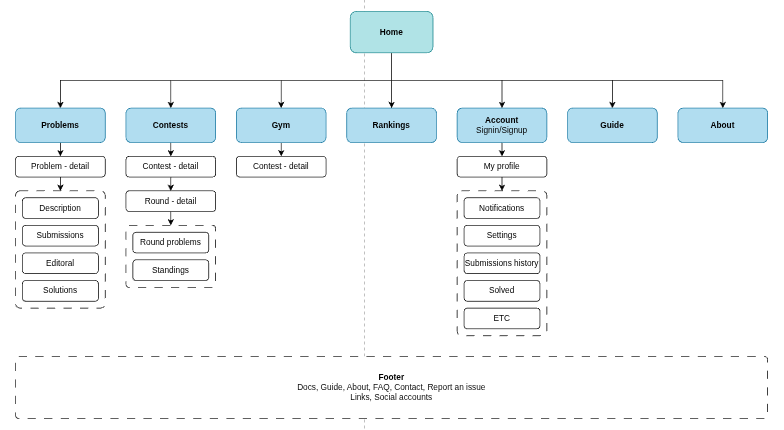
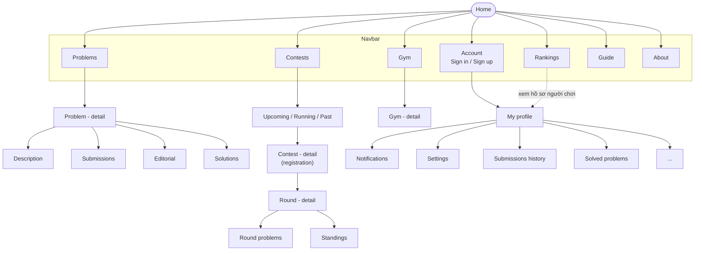

## 1. Cấu trúc thư mục

```
Project/
├── components/
│   ├── header.html
│   └── footer.html
├── css/
│   └── style.css 
├── images/
│   ├── logo.svg
│   └── favicon.svg
├── js/
│   └── main.js
└── template.html        # khung trống: header + <main> + footer
```

## 2. Sơ đồ website (sitemap)

Các trang dự kiến của Astra. Ô tròn là trang chủ, ô trong `Navbar` là các mục hiện trên thanh điều hướng.




## 3. Màu sắc và font

Mọi màu và font nằm ở đầu `css/style.css` dưới dạng CSS variables. Dark mode chỉ ghi đè cùng tên biến trong `[data-theme="dark"]`.

| Biến | Màu | Dùng cho |
|---|---|---|
| `--indigo` | `#6C6CE0` | màu chủ đạo: nút, link, focus |
| `--teal` | `#46D18A` | xanh "terminal": thành công, nhấn phụ |
| `--sandy` | `#D3AD5C` | vàng: nhấn thứ ba |
| `--peach` | `#EAE1C8` | chữ trên nền tối |
| `--oxford` | `#1B1830` | nền footer, bề mặt tối |
| `--orange` | `#B8544E` | chỉ dùng cho cảnh báo / nguy hiểm |

| Theme | Nền | Chữ |
|---|---|---|
| Light | `#F7F7FB` | `#14131F` |
| Dark | `#121022` | `#E8E6F2` |

| Font | Dùng cho |
|---|---|
| Space Grotesk | tiêu đề, logo chữ, nhãn |
| Inter | nội dung thường |
| Fraunces | câu trích / tagline (chữ serif nghiêng) |

Theme được lưu trong `localStorage` (khóa `astra-theme`); lần đầu truy cập sẽ theo cài đặt của hệ điều hành.

---

## 4. Phân công trang (theo sơ đồ)

| Người | Trang |
|---|---|
| Bach | Home (Index), Rankings, Guide, About |
| Khiet | Docs, FAQ, Contact, Report an issue |
| Hoang Anh | Account (Sign in / Sign up / Profile) |
| Bao | Problems |
| Tung An | Contests, Gym |

---
